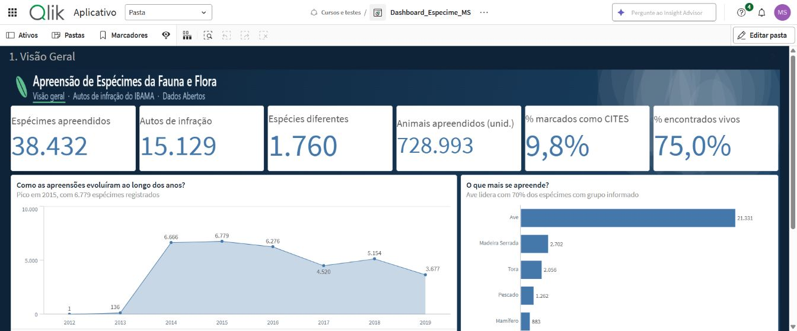
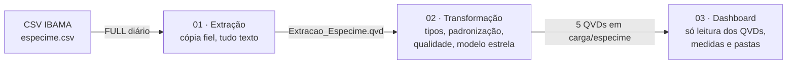
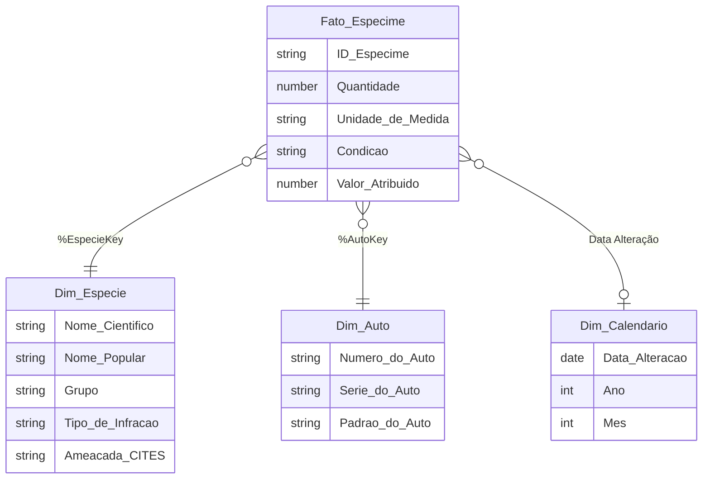
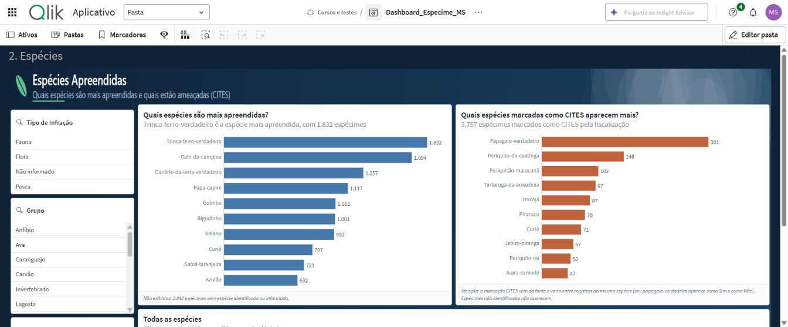
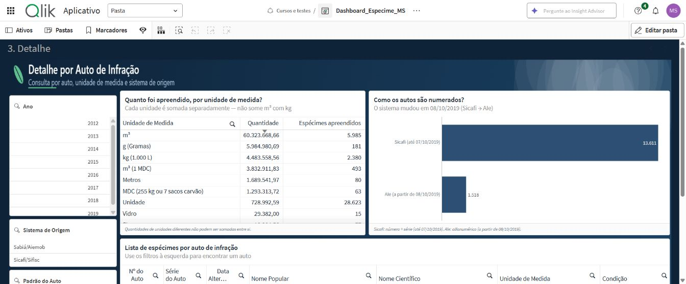

# Apreensão de Espécimes da Fauna e Flora: ETL e Dashboard em Qlik Cloud

Pipeline de dados de ponta a ponta (**extração → transformação → dashboard**) em **Qlik Cloud**, construído sobre dados abertos do **IBAMA** sobre espécimes apreendidos em autos de infração ambiental.

O projeto cobre todo o ciclo de um trabalho de BI: perfilamento da fonte, desenho do modelo, ETL em camadas, validação contra a fonte, um painel fácil de ler e a documentação das decisões e dos problemas de qualidade encontrados nos dados.

---

## Resumo

| | |
|---|---|
| **Fonte** | Portal de Dados Abertos do IBAMA, espécimes vinculados a autos de infração (CSV, atualização diária) |
| **Volume** | 38.432 registros · 20 campos · 2 sistemas de origem (Sicafi/Sifisc e Sabiá/Aiemob) |
| **Ferramenta** | Qlik Cloud (script de carga, QVD, modelo associativo, itens mestres, visualizações) |
| **Arquitetura** | 3 apps em camadas: Extração (cópia fiel) → Transformação (limpeza e modelo estrela) → Dashboard |
| **Modelo** | Esquema estrela: 1 fato e 3 dimensões |
| **Validação** | Reconciliação de 11 indicadores entre painel e CSV bruto: todos batem |
| **Entrega** | Painel com 3 pastas, 8 medidas mestre, títulos em forma de pergunta e conclusões que se recalculam com os filtros |

## Perguntas que o painel responde

1. **O que mais se apreende?** Aves são 70% dos espécimes com grupo informado.
2. **Fauna, flora ou pesca?** Fauna responde por 76% dos espécimes com tipo informado.
3. **Quais espécies são mais apreendidas?** Trinca-ferro-verdadeiro (1.832), galo-da-campina (1.694) e canário-da-terra (1.257), todas aves canoras.
4. **Quanto envolve espécies da lista CITES?** 9,8% dos espécimes estão marcados como CITES na fonte. O mais frequente é o papagaio-verdadeiro (301). A marcação tem ressalvas; veja [Qualidade](docs/03-qualidade-e-validacao.md).
5. **Em que estado os animais foram encontrados?** 75% estavam vivos, entre os casos com condição informada.
6. **Como evoluiu ao longo do tempo?** O pico foi em 2015, com 6.779 registros. A série vai de 2013 a 2019.

## Arquitetura

| Camada | Responsabilidade | Script |
|---|---|---|
| **Extração** | Lê o CSV como **texto**, sem nenhuma regra de negócio, e grava um QVD | [`qlik/01_extracao.qvs`](qlik/01_extracao.qvs) |
| **Transformação** | Converte tipos, padroniza textos, cria chaves, checa a qualidade e monta o modelo estrela | [`qlik/02_transformacao.qvs`](qlik/02_transformacao.qvs) |
| **Dashboard** | Só carrega os QVDs prontos; toda a lógica de indicador fica nas medidas mestre | [`qlik/03_dashboard.qvs`](qlik/03_dashboard.qvs) |

Detalhes em [docs/01-arquitetura.md](docs/01-arquitetura.md).

## Modelo de dados

| Tabela | Linhas | Grão |
|---|---|---|
| Fato_Especime | 38.432 | 1 espécime apreendido |
| Dim_Especie | 5.254 | combinação nome científico + popular + grupo + tipo + CITES |
| Dim_Auto | 15.153 | auto de infração (por código interno; ver limitações) |
| Dim_Calendario | 1.847 | dia |

Detalhes em [docs/02-modelo-de-dados.md](docs/02-modelo-de-dados.md).

## Qualidade e validação dos dados

A validação comparou o painel com um app independente que lê o CSV bruto, sem passar pelo ETL:

| Verificação | CSV bruto | Painel |
|---|---|---|
| Total de registros | 38.432 | 38.432 ✔ |
| Marcados como CITES | 3.757 | 3.757 ✔ |
| Fauna | 28.290 | 28.290 ✔ |
| Aves | 21.331 | 21.331 ✔ |
| Vivos (Vivo + Viva) | 25.999 | 25.999 ✔ |
| Soma das quantidades em "Unidade" | 728.992,591 | 728.992,591 ✔ |
| Soma do valor atribuído | R$ 57.396.722,93 | R$ 57.396.722,93 ✔ |
| Registros por ano (2012 a 2019) | idênticos | idênticos ✔ |

**Problemas encontrados na fonte e como foram tratados** (lista completa em [docs/03-qualidade-e-validacao.md](docs/03-qualidade-e-validacao.md)):

- **Condição (vivo/morto) em texto livre:** "Vivo", "Viva", "Morto", "Morta" e cerca de 120 outros textos → padronizado em Vivo / Morto / Outro / Não informado.
- **Marcação CITES inconsistente:** 447 das 1.760 espécies têm registros marcados e não marcados como CITES. O indicador foi renomeado para "% marcados como CITES" e ganhou uma nota explicativa.
- **"Não identificado":** 507 registros sem espécie identificada (181 marcados como CITES) apareciam como se fossem uma espécie no ranking. Foram removidos dos rankings, com aviso no rodapé.
- **Autos contados em dobro:** o mesmo número de auto aparecia com dois códigos internos e o KPI contava 24 autos a mais. A medida foi corrigida para número + série.
- **Separador decimal:** o CSV usa ponto ("170010.0"), e o Qlik em pt-BR leria "1.0" como 10. Por isso a extração guarda tudo como texto e a conversão é feita de forma explícita.
- **Datas inválidas:** 2 registros com data em 2045 foram tratados como inválidos, e 5.221 registros não têm data.

## Painel

| Pasta | Conteúdo |
|---|---|
| **1. Visão Geral** | 6 KPIs, evolução por ano, grupos, condição e fauna/flora/pesca |
| **2. Espécies** | Filtros, top 10 espécies, top 10 marcadas como CITES, tabela de espécies |
| **3. Detalhe** | Filtros, quantidade por unidade, padrão de numeração dos autos, lista por auto |

Princípios de design aplicados:
- **Títulos em forma de pergunta.**
- **Uma frase de conclusão automática** sob cada gráfico ("Pico em 2015, com 6.779 espécimes registrados"), que se recalcula com os filtros.
- **"Não informado" fora dos rankings**, com o total excluído informado no rodapé.
- **Fonte e data dos dados visíveis**, e quantidades sempre separadas por unidade de medida.

| | |
|---|---|
|  |  |

Fórmulas das medidas e decisões visuais em [docs/05-painel-e-medidas.md](docs/05-painel-e-medidas.md).

## Decisões técnicas

Registradas como ADRs em [docs/04-decisoes-tecnicas.md](docs/04-decisoes-tecnicas.md). Entre elas:
- por que a extração é sempre FULL;
- por que tudo vira texto na extração;
- como o ID do espécime foi definido, já que cada sistema de origem tem a sua chave;
- chaves com Hash128;
- fundo do painel por imagem na biblioteca de mídia, porque não havia permissão para instalar tema.

## Como reproduzir

1. Baixe o CSV de espécimes dos autos de infração no [Portal de Dados Abertos do IBAMA](https://dadosabertos.ibama.gov.br) e envie-o para um espaço do Qlik Cloud.
2. Crie 3 apps e cole os scripts da pasta [`qlik/`](qlik/). Ajuste o nome da conexão (`lib://<seu espaço>:DataFiles/...`) na aba **Parâmetros** de cada um.
3. Recarregue na ordem: **Extração → Transformação → Dashboard**.
4. Crie as medidas mestre listadas em [docs/05-painel-e-medidas.md](docs/05-painel-e-medidas.md).

## Limitações conhecidas e próximos passos

- **CITES oficial:** cruzar o nome científico com a lista oficial (Species+/CITES) para classificar cada espécie de forma única, sem depender da marcação feita por registro.
- **Data e local da infração:** esta base só tem a data de alteração no sistema. Cruzar com a base de **Autos de Infração** do IBAMA pelo `SEQ_AUTO_INFRACAO` traria data real, UF e município (série histórica e mapa).
- **Chave da Dim_Auto:** inclui o código interno do sistema. O KPI já conta número + série corretamente, mas o ideal é corrigir a chave na Transformação.
- **Robustez da extração:** recolocar a checagem de "arquivo não encontrado" e a proteção que evita gravar um QVD vazio.
- **Orquestração:** encadear os recarregamentos (Extração → Transformação → Dashboard) numa automação do Qlik.

## Habilidades demonstradas

`Qlik Sense / Qlik Cloud` · `Script de carga (LOAD, preceding load, ApplyMap, variáveis com parâmetro, QVD)` · `Modelagem dimensional (esquema estrela)` · `Qualidade de dados e reconciliação` · `Set Analysis` · `Itens mestres` · `Data storytelling` · `Documentação técnica (ADR)` · `Dados abertos governamentais`

## Autor

**Maelsousa** · [github.com/Maelsousa](https://github.com/Maelsousa)

Os dados pertencem ao IBAMA e são publicados como dados abertos. Este repositório contém apenas código, documentação e imagens do painel.
