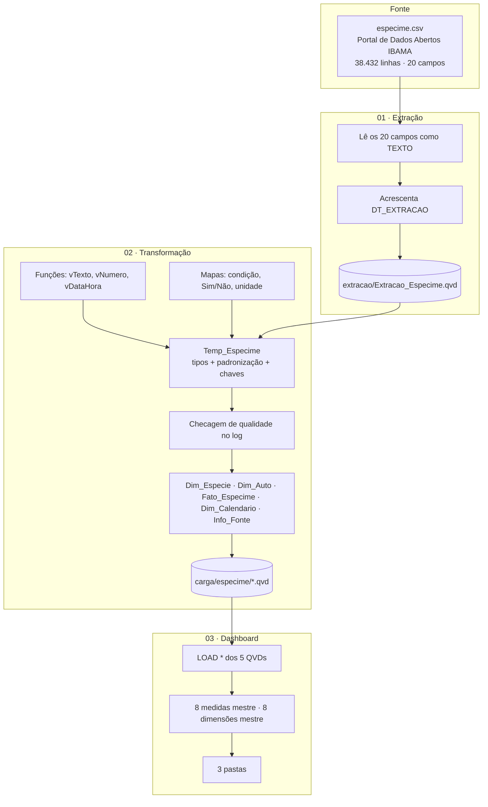

# 01 · Arquitetura

## Visão geral

O projeto é dividido em **três apps Qlik**, um por camada. Cada camada grava QVDs que a seguinte lê. Assim, um problema pode ser isolado na etapa em que aconteceu.



## Responsabilidade de cada camada

### 01 · Extração
- **Faz:** lê o CSV (`utf8`, separador `;`, cabeçalho na 1ª linha), converte os 20 campos com `Text()` e grava `Extracao_Especime.qvd`.
- **Não faz:** nenhuma limpeza, renomeação ou regra de negócio.
- **Por quê:** o QVD da extração é uma **cópia fiel da fonte** e serve de referência para auditoria. Se um número divergir no painel, dá para saber se o problema veio da fonte ou da transformação.
- **Modo de carga:** sempre FULL (ver [ADR-001](04-decisoes-tecnicas.md#adr-001--extração-sempre-full)).

### 02 · Transformação
Ordem de execução:

| Aba | O que faz |
|---|---|
| Parâmetros | Caminho do QVD de extração e da pasta de carga |
| Funções | `vTexto` (vazio → "Não informado"), `vNumero` (ponto decimal → número), `vDataHora` (texto ISO → data/hora) |
| Mapas | `Map_Condicao` (vivo/viva/morto/morta), `Map_SimNao` (S/N), `Map_Unidade` (m³/M³) |
| Temp_Especime | Conversão de tipos e padronização (1º LOAD); chaves e campos derivados (preceding load) |
| Qualidade | Conta linhas × IDs distintos, falhas de conversão e datas futuras, e escreve no log |
| Dim_Especie / Dim_Auto / Fato_Especime / Dim_Calendario | Modelo estrela |
| Info_Fonte | Tabela de 1 linha com a data da fonte e da extração, mostrada no painel |
| STORE | Grava os 5 QVDs em `carga/especime/` |

Saída do log na última execução:
```
Linhas: 38432 · IDs distintos: 38432 (devem ser iguais)
Falhas de conversão -> quantidade: 0 · valor: 0 · data: 0
Datas futuras descartadas: 2
Fato_Especime: 38432 · Dim_Especie: 5254 · Dim_Auto: 15153 · Dim_Calendario: 1847
```

### 03 · Dashboard
- O script só faz `LOAD *` dos QVDs, **sem nenhuma regra**.
- Toda a lógica de indicador fica nas **medidas mestre**: uma única definição, usada em todos os objetos.
- Pastas, gráficos e estilo estão descritos em [05-painel-e-medidas.md](05-painel-e-medidas.md).

## Ordem de recarga

```
Extração  →  Transformação  →  Dashboard
```
Cada app depende do QVD gerado pelo anterior. O próximo passo recomendado é encadear as três recargas numa automação do Qlik Cloud.

## Convenções
- Campos de medida com prefixo `#` (`#Quantidade`, `#Valor Atribuído`).
- Chaves técnicas com prefixo `%` (`%EspecieKey`, `%AutoKey`), para ficarem separadas dos campos de negócio.
- Nomes de campos em português, prontos para o usuário final.
- Textos ausentes padronizados como **"Não informado"**.
