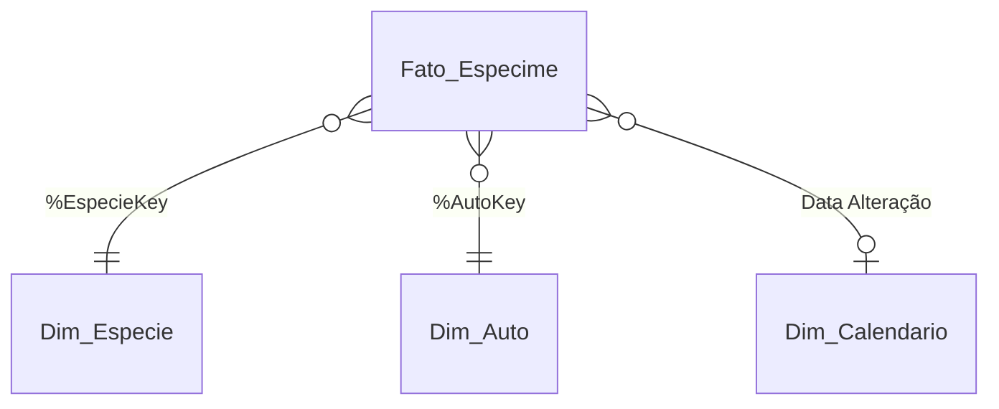

# 02 · Modelo de dados

## Esquema estrela

`Info_Fonte` é uma tabela de 1 linha, **sem ligação** com as demais. Ela só serve para mostrar no painel a data dos dados.

## Tabelas

### Fato_Especime (38.432 linhas)
**Grão:** 1 espécime apreendido (registro da fonte).

| Campo | Tipo | Origem / regra |
|---|---|---|
| ID Espécime | texto | `SICAFI-<SEQ_ESPECIME>` ou `SABIA-<CD_ESPECIME>` (cada sistema tem a sua chave) |
| %EspecieKey | chave | Hash128 dos atributos da espécie |
| %AutoKey | chave | Hash128 de Seq. Auto + Nº do Auto + Série |
| Data Alteração | data | `DAT_ALTERACAO` convertida; vazia se nula ou futura |
| Qualidade da Data | texto | Válida / Sem data / Data futura (inválida) |
| Sistema de Origem | texto | Sicafi/Sifisc (34.668) ou Sabiá/Aiemob (3.764) |
| #Quantidade | número | `QUANTIDADE` lida com ponto decimal |
| Unidade de Medida | texto | `UNIDADE_MEDIDA` padronizada (m³/M³ → m³) |
| Forma Encontrada | texto | `DESCRICAO` (espécime, carne, partes, pele…) |
| Condição | texto | `CARACTERISTICA` → Vivo / Morto / Outro (texto livre) / Não informado |
| Característica (original) | texto | Texto original, preservado para consulta |
| Perecível | texto | `ST_PERECIVEL` S/N → Sim/Não |
| Situação | texto | `SITUACAO` (94% vazio na fonte) |
| #Valor Atribuído | número | `NU_VALOR`, que **só existe no Sabiá/Aiemob** |

### Dim_Especie (5.254 linhas)
| Campo | Origem |
|---|---|
| %EspecieKey | Hash128(Nome Científico, Nome Popular, Grupo, Tipo de Infração, Ameaçada (CITES)) |
| Nome Científico | `NOME_CIENTIFICO` |
| Nome Popular | `NOME_POPULAR` |
| Grupo | `GRUPO` (ave, mamífero, madeira serrada…) |
| Tipo de Infração | `TIPO` (fauna, flora, pesca) |
| Ameaçada (CITES) | `CITES` S/N → Sim/Não |

> Por que não usar `SEQ_TAXONOMIA` como chave? Ela só está preenchida em 1.013 das 38.432 linhas. Além disso, o mesmo nome científico aparece com grupo e marcação CITES diferentes. Por isso a chave combina os atributos.

### Dim_Auto (15.153 linhas)
| Campo | Origem |
|---|---|
| %AutoKey | Hash128(Seq. Auto, Nº do Auto, Série do Auto) |
| Seq. Auto | `SEQ_AUTO_INFRACAO` |
| Nº do Auto | `NUM_AUTO_INFRACAO` em maiúsculas e sem espaços |
| Série do Auto | `CD_SERIE_AUTO_INFRACAO` em maiúsculas; vazio → "Sem série" |
| Padrão do Auto | Com série → Sicafi (até 07/10/2019); sem série → AIe (a partir de 08/10/2019) |

> **Limitação conhecida:** como a chave inclui o código interno (`Seq. Auto`), 24 autos aparecem com duas chaves. O KPI de autos usa `Count(DISTINCT [Nº do Auto] & '|' & [Série do Auto])` = **15.129**, que é o valor correto. O próximo passo é tirar `Seq. Auto` da chave na Transformação.

### Dim_Calendario (1.847 linhas)
| Campo | Regra |
|---|---|
| Data Alteração | datas distintas da fato (sem nulos) |
| Ano, Mês | `Year()`, `Month()` |
| Trimestre | `Dual('T1'…'T4', 1…4)` |
| Mês/Ano | `Date(MonthStart(), 'MMM/YYYY')` |

> A única data da fonte é a **data de alteração no sistema**, não a data da infração. Isso aparece no rodapé do gráfico de evolução anual.

### Info_Fonte (1 linha)
`Atualização da Fonte` (campo `ULTIMA_ATUALIZACAO_RELATORIO`) e `Data da Extração`.

## Dicionário da fonte (IBAMA)

| Campo original | Descrição (dicionário oficial, resumido) |
|---|---|
| SEQ_AUTO_INFRACAO | Chave sequencial do auto de infração |
| NUM_AUTO_INFRACAO | Número do auto (numérico + série até 07/10/2019; alfanumérico no AIe depois) |
| CD_SERIE_AUTO_INFRACAO | Série do auto (não preenchida no AIe) |
| SEQ_TAXONOMIA | Chave da taxonomia (Sistaxon) |
| SEQ_ESPECIME | Chave do espécime no Sicafi/Sifisc |
| CD_ESPECIME | Código do espécime no Sabiá/Aiemob |
| QUANTIDADE / UNIDADE_MEDIDA | Quantidade apreendida e unidade |
| DESCRICAO | Forma encontrada: artesanato, carne, partes, pele, taxidermizado |
| CARACTERISTICA | Vivo ou morto |
| ST_PERECIVEL | Perecível S/N |
| TIPO | Fauna, flora, pesca |
| GRUPO | Grupo de organismos |
| NOME_CIENTIFICO / NOME_POPULAR | Nomes previstos no Sistaxon |
| CITES | Espécie na lista CITES (comércio internacional controlado) |
| SITUACAO | Situação do espécime |
| DAT_ALTERACAO | Data de alteração no sistema |
| NU_VALOR | Valor atribuído ao espécime |
| ULTIMA_ATUALIZACAO_RELATORIO | Data da última atualização do relatório |
